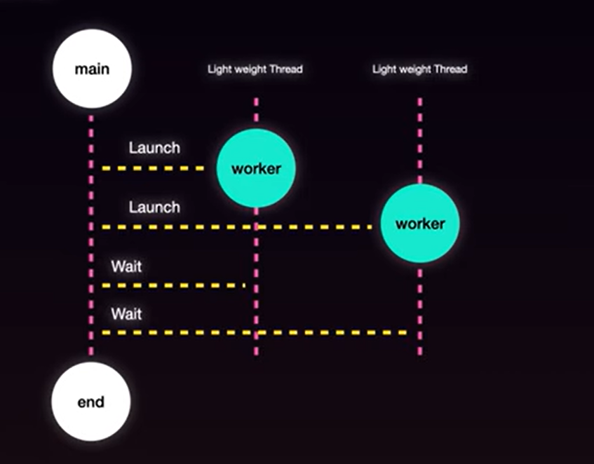
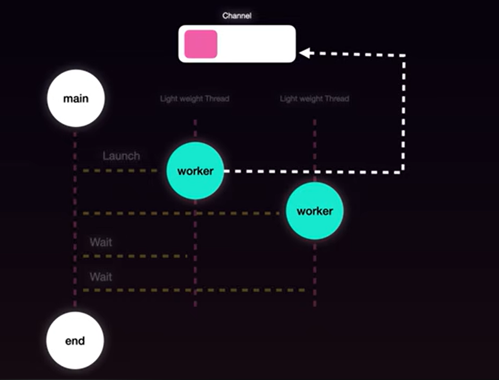
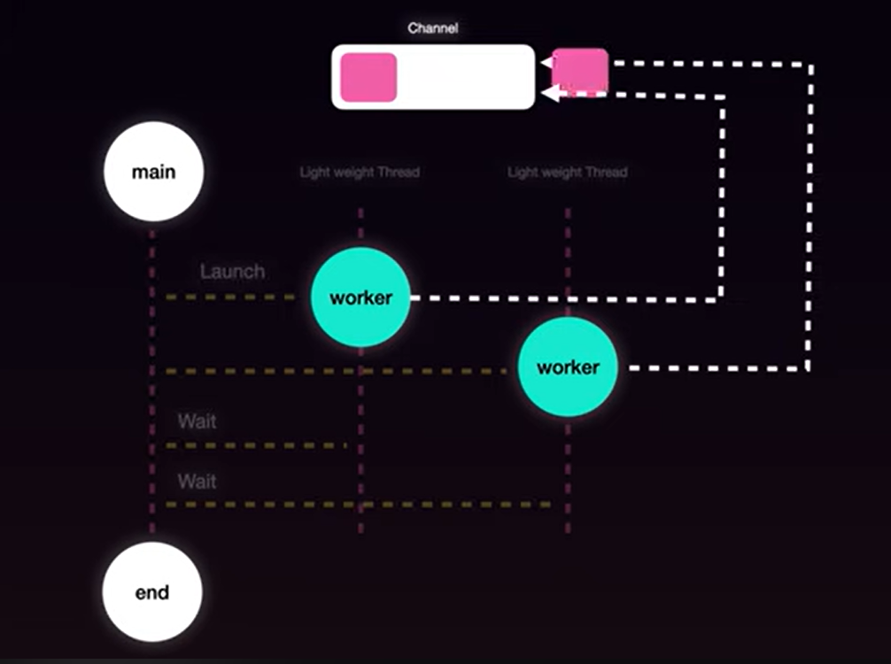
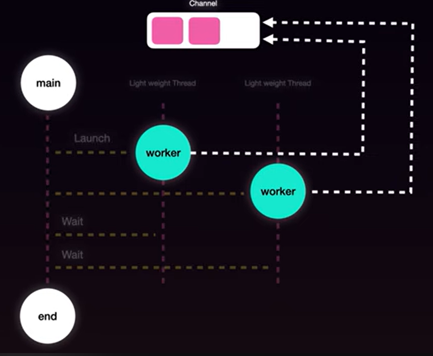
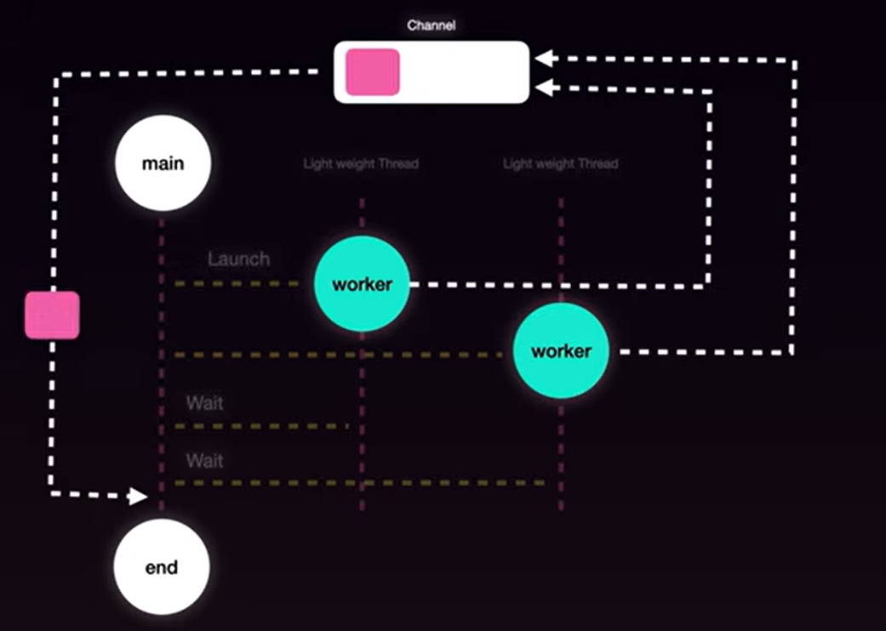
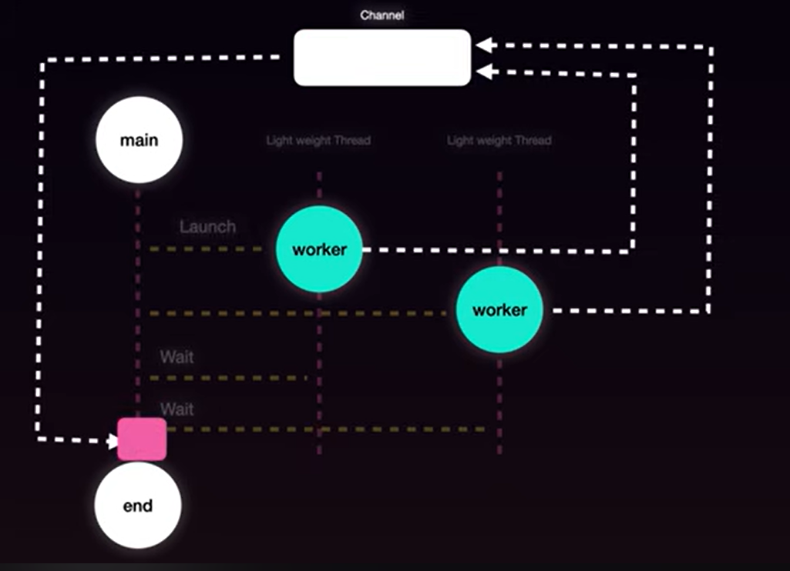
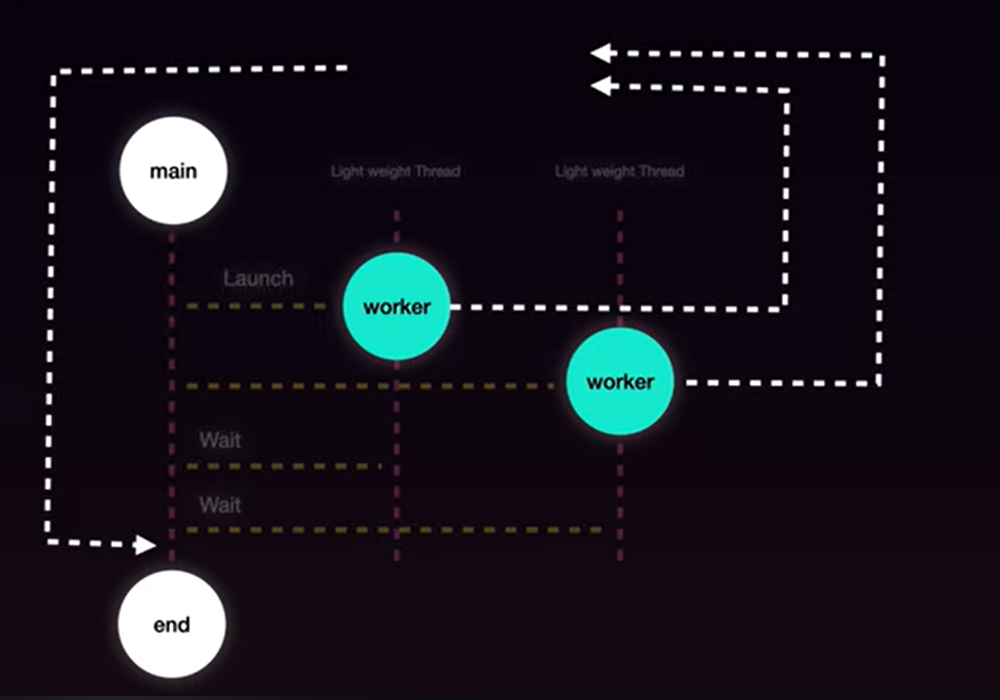
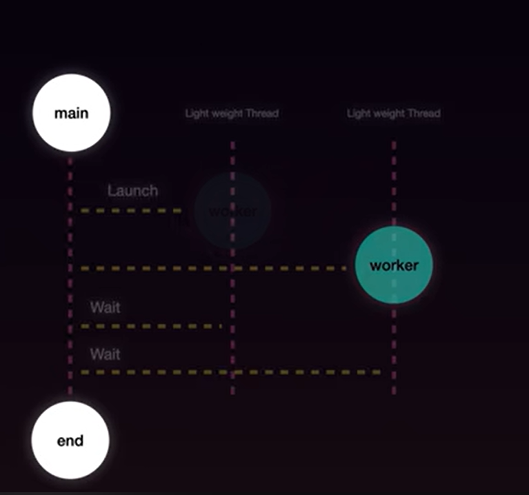

if we dont wait for the go routine to finish executing, the main function will exit and the go routine will be terminated before it can complete its execution.

because go keyword just assures that the function will be executed in a separate go routine, it does not wait for the function to finish executing before moving on to the next line of code.

channel is just a shared memory space that can be given to all go routines to communicate via memory space. we can use channel to send and receive data between go routines.

they work in FIFO manner, (just like queues)

main goroutine will read from the channel amd process it

when done we close the channel to signal that no more data will be sent on the channel. this is important because if we dont close the channel, the main goroutine will keep waiting for data to be sent on the channel and will never exit.

then all workers will exit and main goroutine will exit as well.

https://chatgpt.com/c/6ae7909e-1b94-83e8-9213-bd7f9054a152