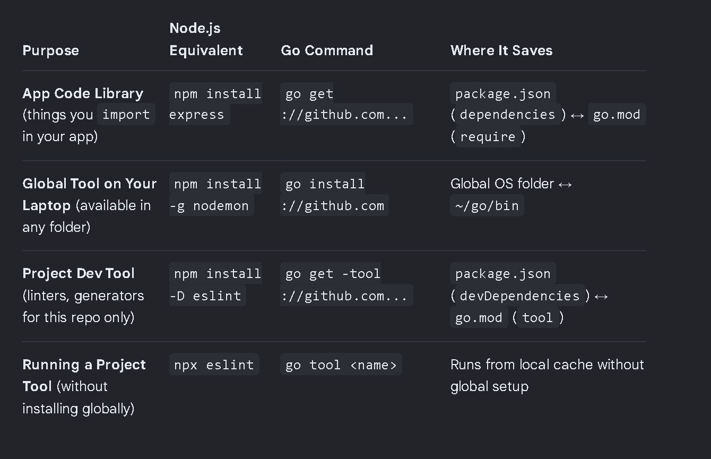

# Passing Environment Variables to Language Tools

## Core Concept

Prefixing a command (`VAR=value command`) in Linux/macOS shells passes environment variables to both the **language runtime** and any **underlying build/compiler tools** (like `cgo`, `node-gyp`, or `pip`).

---

## Quick Reference Table

| Language    | Inline Command (Linux/macOS) | Read in Code            | Common Tool/Compiler Vars               |
| :---------- | :--------------------------- | :---------------------- | :-------------------------------------- |
| **Go**      | `VAR=val go run main.go`     | `os.Getenv("VAR")`      | `CGO_ENABLED`, `CC`, `GOOS`, `GOARCH`   |
| **Node.js** | `VAR=val node app.js`        | `process.env.VAR`       | `NODE_ENV`, `NODE_OPTIONS`, `CC`, `CXX` |
| **Python**  | `VAR=val python app.py`      | `os.environ.get("VAR")` | `PYTHONPATH`, `PYTHONUNBUFFERED`, `CC`  |

---

## Key Examples

### 1. Go (`cgo` & Cross-Compilation)

- **Custom C compiler:** `CGO_ENABLED=1 CC=clang go run main.go`
- **App variable:** `API_KEY=123 go run main.go`
- _Note:_ Variables must go **before** `go run`, never after.

### 2. Node.js (`node-gyp` & Runtime)

- **Native build tools:** `CC=clang CXX=clang++ npm install`
- **App variable:** `NODE_ENV=production node app.js`

### 3. Python (`pip` C-Extensions & Runtime)

- **Build C extensions:** `CC=gcc CFLAGS="-O2" pip install package_name`
- **Module path & App variable:** `PYTHONPATH=./src DEBUG=1 python app.py`

---

## Windows PowerShell Note

Inline prefixing does **not** work in PowerShell. Set the variable first:

```powershell
\$env:VAR="value"; python app.py
```

# Go Cross-Compilation (`go tool dist list`) Cheat Sheet

## Why Go Supports So Many Targets

Go's compiler has **built-in cross-compilation** and bundles its own runtime (garbage collector, scheduler, networking) into a single static binary. With `CGO_ENABLED=0`, you can compile native binaries for almost any OS/CPU combination from a single computer without needing external toolchains or virtual machines.

---

## Target Categories, Build Commands & Outputs

| Category                  | Build Command (`GOOS` & `GOARCH`)                         | What You Get (Output)                      | Primary Use Cases                                                                |
| :------------------------ | :-------------------------------------------------------- | :----------------------------------------- | :------------------------------------------------------------------------------- |
| **Linux Server (x86_64)** | `GOOS=linux GOARCH=amd64 go build -o app-linux main.go`   | ELF 64-bit executable (`app-linux`)        | Standard cloud servers (AWS/GCP), Docker containers, and Linux desktops.         |
| **Linux ARM / Cloud**     | `GOOS=linux GOARCH=arm64 go build -o app-arm64 main.go`   | ELF ARM64 executable (`app-arm64`)         | Energy-efficient cloud servers (AWS Graviton) and modern Raspberry Pis (64-bit). |
| **macOS (Apple Silicon)** | `GOOS=darwin GOARCH=arm64 go build -o app-mac main.go`    | Mach-O ARM64 binary (`app-mac`)            | Native CLI tools and apps for M1/M2/M3/M4 Macs (use `amd64` for Intel Macs).     |
| **Windows (64-bit)**      | `GOOS=windows GOARCH=amd64 go build -o app.exe main.go`   | PE32+ Windows executable (`app.exe`)       | Windows desktops, servers, and CLI tools (must include `.exe` extension).        |
| **Embedded & Routers**    | `GOOS=linux GOARCH=mipsle go build -o app-router main.go` | MIPS Little-Endian binary (`app-router`)   | Wi-Fi routers (OpenWrt), smart cameras, and IoT devices with tiny storage.       |
| **Browser WebAssembly**   | `GOOS=js GOARCH=wasm go build -o main.wasm main.go`       | WebAssembly bytecode module (`main.wasm`)  | Running Go code directly inside web browsers alongside JavaScript.               |
| **Serverless / WASI**     | `GOOS=wasip1 GOARCH=wasm go build -o plugin.wasm main.go` | WASI-compliant WebAssembly (`plugin.wasm`) | Secure edge workers, plugin systems, and non-browser sandboxes.                  |
| **Mobile (Android/iOS)**  | `gomobile bind -target=android ./...` _(or `ios`)_        | `.aar` (Android) or `.xcframework` (iOS)   | Native mobile libraries to share core Go logic with Kotlin/Java or Swift apps.   |
| **Enterprise Mainframes** | `GOOS=linux GOARCH=s390x go build -o app-z main.go`       | IBM Z mainframe binary (`app-z`)           | Banking, insurance, and government IBM Z mainframes (`aix/ppc64` for IBM Power). |
| **BSD Firewalls**         | `GOOS=freebsd GOARCH=amd64 go build -o app-bsd main.go`   | FreeBSD ELF executable (`app-bsd`)         | Firewalls (pfSense/OPNsense), network appliances, and dedicated BSD servers.     |

---

## Pro-Tips for Clean Releases

- **Disable Cgo for pure Go builds:** Prefix with `CGO_ENABLED=0` to ensure zero dynamic C-library dependencies.
- **Shrink binary size:** Add `-ldflags="-s -w"` to strip debug symbols and reduce file size by ~30%:
  ```bash
  CGO_ENABLED=0 GOOS=linux GOARCH=amd64 go build -ldflags="-s -w" -o app-linux main.go
  ```


