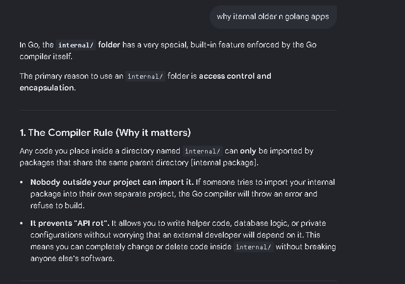
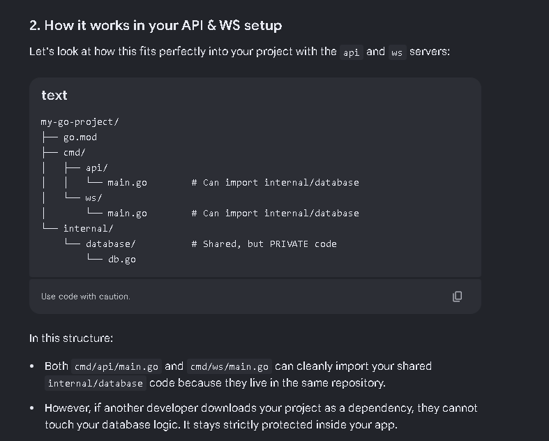
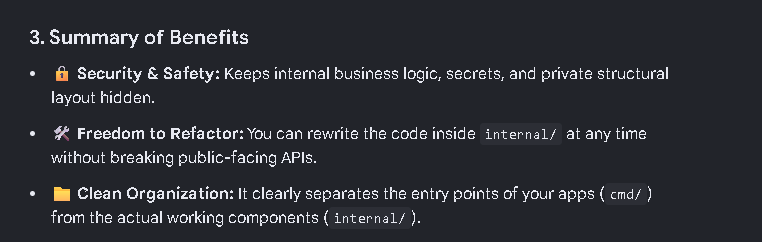

## How to setup golang projects 


Like other language or nodje swe have a command to intialize a goLang Project 

Run `go mod init github.com/username/projectname` to initialize a new Go module. This will create a `go.mod` file in your project directory.

Create a main.go file in your project directory. This will be the entry point of your application.

Executing go app 

`go run main.go` to run the application. This will compile and execute the code in the main.go file.

go run command does build + execute 

This is good for development and testing, but for production, you may want to build a binary executable. 

To actually build the application, run `go build`. This will create an executable file in your project directory.   

`go build -o bin/main main.go` 

to build the application and specify the output binary name and location. This will create an executable file named `main` in the `bin` directory. 


Run the binary using `./bin/main`  on linux or `bin\main.exe` on Windows. This will execute the compiled binary.


Shortcut create a Makefile to automate the build and run process.  

Makefile is a task runner that gives a tool called make to automate the build and run process.

```Makefile

build:
    go build -o bin/main main.go

run: 
    ./bin/main

```


Then now run them via `make build` to build the application and `make run` to run the application. This will execute the commands defined in the Makefile.

This is same as using scripts of package.json in nodejs projects.

But above makefile shows even the command that got executed to prevent that add @ before the command in the makefile. 

```Makefile

build:
    @go build -o bin/main main.go   

run:
    @./bin/main

```


But issue is there when i change the build path to build/bin/main then the run command will not work because it will not find the binary in the specified path.

to fix this we need to add .PHONY to the makefile to tell make that the run command is not a file but a command to be executed.

```Makefile 

.PHONY: build run

build:
    @go build -o build/main main.go

run : build  // this will make sure that the build command is executed before the run command
    @./build/main
```


when you multiple entry points in your project you can create a separate folder for each entry point and create a main.go file in each folder.

put them all under cmd folder and then you can build them separately using the go build command.

```bash     

.PHONY: build run

build:
	@go build -o bin/api ./cmd/api 
	@go build -o bin/ws ./cmd/ws  
	
# figures or automatically for mian.go when we specify path i.e cmd/ws or cmd/api figure out thereis a main.go having main() function
run : build  
#  this will make sure that the build command is executed before the run command
	@./bin/api

```


# why internal/ folder is used in goLang projects





