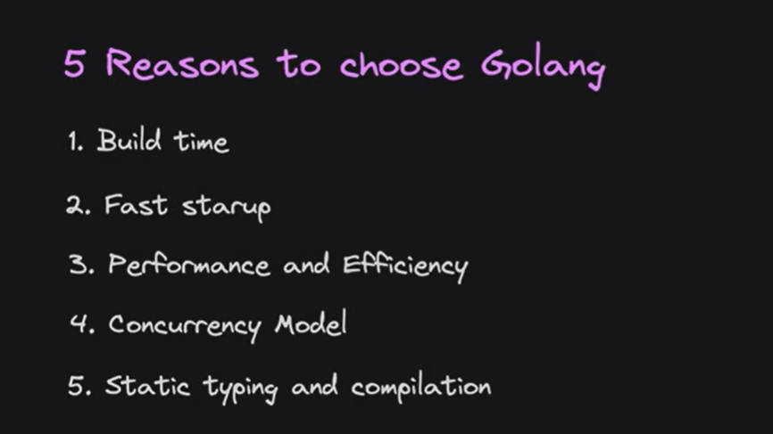
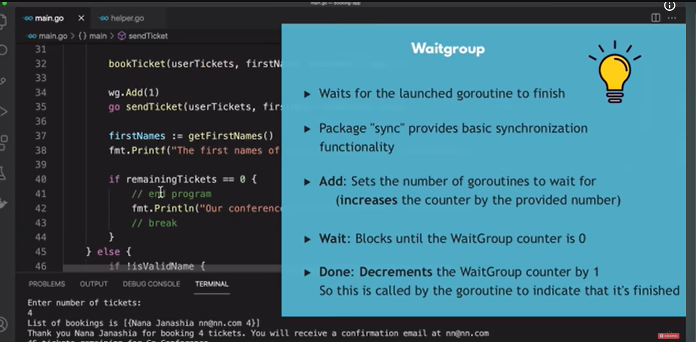

# GoLang

- Go Lang is fast , performant and efficient programming language.
- backed by google and open source community.
- directly compiled to machine code, which makes it faster than interpreted languages.
- concurrency model beats java due to light weight threads (goroutines) powerful multithreaded applications
- All devops tools are written in GoLang (Docker, Kubernetes, Terraform, etc)



Build time : CI-CD pipeline less cost as faster go program builds

Fast Startup : GoLang is compiled language, so it starts faster than interpreted languages like python, ruby, etc

(this is important for microservices architecture where we have multiple services running in parallel) we want new instance to spin up fast and handle requests as soon as possible. (Horizontal scaling)

Efficient usage of memory and cpu (via goroutines) : GoLang is designed to be efficient in terms of memory and CPU usage. It uses goroutines, which are lightweight threads that allow for concurrent execution of code. This means that GoLang can handle a large number of concurrent requests without consuming too much memory or CPU resources.

efficient usage of cpu (concurrency model) : GoLang's concurrency model is based on goroutines and channels, which allows for efficient communication between concurrent processes. This means that GoLang can handle multiple requests simultaneously without blocking or slowing down the application.

also when we build the compiled binary is very smaller in size

## Installation

Download GO onto your system from the official website:

`    https://go.dev/dl/`

Install this extension in vscode for go synatx highlighting and suggestions


Build go program to generate executable binary file using the following command

` go build <path_to_your_go_file>`

To run directly use

`go run <path_to_your_go_file>`

main is the entry point of a go application same like c/c++/java

go coroutines let use run code on separate lightweight threads, which allows for concurrent execution of code. This means that GoLang can handle a large number of concurrent requests without consuming too much memory or CPU resources.

coroutines are lightweight threads and more cheaper to create than actual os threads.

and communication between goroutines is done using channels, which allows for efficient communication between concurrent processes. This means that GoLang can handle multiple requests simultaneously without blocking or slowing down the application.

Java now does this using virtual threads but go has been doing this for a long time and is more efficient than java virtual threads.




go has no classes we create custom types and blueprints via structs and methods. we can create methods on structs and use them like classes in oop languages.

interface define contract just like other laguages, we can implement interfaces on structs and use them like classes in oop languages.

enums are implememted via const and iota in go. we can create enums using const and iota.

# Go Pointers and "Reference Types"

**Yes, pointers work on "reference types" in Go, but you almost never need them.** 

Technically speaking, Go is strictly a **pass-by-value language**. What developers commonly call "reference types" (like **slices, maps, and channels**) are actually small struct headers that internally contain a pointer to an underlying data structure. 

Because they already hold internal pointers, passing a map or a slice to a function copies the lightweight header, but still points to the exact same underlying data. 

---

### When pointers to reference types are actually useful

You only use a pointer to a reference type if you need to **modify the header itself** (such as changing its memory address, length, or capacity).

#### 1. Slices (`*[]T`)
If you pass a slice directly to a function and use `append()`, a re-allocation might trigger. This creates a new underlying array and updates the header's length/capacity, but that update is lost to the caller. You use a pointer to ensure the caller sees the assignment.

```go
// Without a pointer: The caller's slice won't see the new element if it reallocates
func failAppend(s []int) {
    s = append(s, 42) 
}

// With a pointer: Modifies the caller's slice header directly
func successAppend(s *[]int) {
    *s = append(*s, 42) 
}
```

#### 2. Maps (`*map[K]V`)
You almost **never** need a pointer to a map (`*map[string]int`) because modifying, adding, or deleting keys alters the underlying data structure directly. The only exception is if you want to initialize a `nil` map inside a function and have that initialization reflect back to the caller:

```go
func initializeMap(m *map[string]int) {
    if *m == nil {
        *m = make(map[string]int) // Instantiates the map for the caller
    }
    (*m)["status"] = 200
}
```

---

### Summary Reference Guide

| Type | Do you need a pointer (`*`) to mutate data? | Reason |
| :--- | :--- | :--- |
| **Slices** | **Only** if changing length/capacity (`append`) | Internal header has pointer, length, and capacity. |
| **Maps** | **No** (Except to assign a brand new map) | Maps are already pointers to runtime descriptors under the hood. |
| **Channels**| **No** | Channels are handles to a shared queue pointer. |


# Go Language "Char" Data Type Summary

In **Go (Golang)**, there is no explicit `char` data type. Instead, Go handles characters using two distinct numeric types wrapped in single quotes (`'a'`):

* **`rune`**: An alias for **`int32`**. It represents a Unicode code point. It uses **4 bytes** of memory and can store any character, including emojis, Chinese characters, and special symbols.
* **`byte`**: An alias for **`uint8`**. It uses **1 byte** of memory and is used to store standard ASCII characters.

---

### Copyable Code Example

```go
package main

import (
	"fmt"
	"reflect"
)

func main() {
	// 1. Using a 'rune' for Unicode/UTF-8 characters
	var myRune rune = 'A'
	speciaChar := '🚀' // Infers as rune automatically

	// 2. Using a 'byte' for basic ASCII characters
	var myByte byte = 'a'

	// Printing values
	fmt.Println("--- Character Values ---")
	fmt.Printf("myRune (Character): %c\n", myRune)
	fmt.Printf("myRune (Unicode Code Point): %d\n", myRune)
	fmt.Printf("speciaChar (Character): %c\n", speciaChar)
	fmt.Printf("myByte (Character): %c\n", myByte)

	// Printing underlying types
	fmt.Println("\n--- Underlying Types ---")
	fmt.Println("myRune type:", reflect.TypeOf(myRune))       // int32
	fmt.Println("speciaChar type:", reflect.TypeOf(speciaChar)) // int32
	fmt.Println("myByte type:", reflect.TypeOf(myByte))       // uint8

	// 3. Iterating over a string returns runes
	fmt.Println("\n--- Iterating a String ---")
	str := "Go🏃"
	for index, char := range str {
		fmt.Printf("Index: %d | Character: %c | Type: %s\n", index, char, reflect.TypeOf(char))
	}
}
```

---

### Core Mechanics Comparison

| Feature | `byte` | `rune` |
| :--- | :--- | :--- |
| **Underlying Type** | `uint8` (1 byte) | `int32` (4 bytes) |
| **Primary Use Case** | Standard **ASCII** text data | Complete **Unicode / UTF-8** symbols |
| **Syntax Declaration** | Single quotes (e.g., `'a'`) | Single quotes (e.g., `'🚀'`) |
| **String Loops** | Standard `for i` loop accesses raw bytes | `for range` loop automatically decodes runes |


go build (build the binary executble or .exe based on your os (windows/linux/mac))

go build -o <output_file_name> (builds the binary executable with the given name)

go.mod is like the package.json file in nodejs or pom.xml in java. It contains the dependencies of your go project.

go.sum is like the package-lock.json file in nodejs  It contains the dependencies of your go project.it locks all the versions of the packages being used in your project. It is automatically generated when you run `go mod tidy` or `go mod vendor`. It is used to ensure that the same versions of the packages are used across different environments and machines.

Best docs for learning goLang are:

https://go.dev/tour/basics/2

https://gobyexample.com/

https://go.dev/doc/effective_go

https://go.dev/ref/spec


Official standard library of go package 

https://pkg.go.dev/std

https://pkg.go.dev/strings@go1.27.2#ToUpper

https://pkg.go.dev/os@go1.27.2


## Web Frameworks in GoLang 


Gin - Gin is a web framework written in Go (Golang). It is designed to be fast, efficient, and easy to use, making it a popular choice for building web applications and APIs. Gin provides a simple and intuitive API for routing, middleware, and request handling, and it is optimized for performance and scalability. It also includes features such as JSON validation, error handling, and rendering templates.

https://gin-gonic.com/en/docs/

Fiber - just like expressjs in nodejs. It is a fast, minimalist web framework for Go that is designed to be easy to use and efficient. It provides a simple and intuitive API for building web applications and APIs, and it is optimized for performance and scalability. Fiber is built on top of the Fasthttp package, which is a high-performance HTTP server library for Go.

https://gofiber.io/


echo = Echo is a high-performance, extensible, and minimalist web framework for Go (Golang). It is designed to be fast and efficient, making it a popular choice for building web applications and APIs. Echo provides a simple and intuitive API for routing, middleware, and request handling, and it is optimized for performance and scalability. It also includes features such as request validation, error handling, and rendering templates.

https://echo.labstack.com/


## Go Commands 

# Go (Golang) Backend Package Management Summary

## 1. The `go get -u` Command
* **`go get`**: Adds, updates, or removes dependencies in your project's `go.mod` file.
* **`-u` (Update)**: Instructs Go to actively scan the network and update the named package and all of its dependencies to their latest compatible minor or patch releases. 
* **Note**: Without `-u`, Go will only download the specific version needed or keep your existing `go.mod` versions locked as they are.

---

## 2. Core Backend Development Commands

* **`go mod init <name>`**: Initializes a new backend project and creates the `go.mod` file to track libraries.
* **`go run main.go`**: Compiles code into temporary memory and starts your backend locally for instant testing.
* **`go mod tidy`**: Cleans your project by downloading missing imports and removing unused libraries.
* **`go test ./...`**: Runs all unit and integration tests across your entire project directory structure.
* **`go build -o <binary-name> main.go`**: Compiles your backend into a single, production-ready binary executable file (`-o` stands for output).

---

## 3. Global Tools vs. Project Dependencies

Go handles system-wide tools differently than local project code libraries:

### 🌍 Global Tools
* **What they are**: Executable command-line programs installed once onto your entire machine. They live in your system's `~/go/bin` directory.
* **Installation**: Always use `go install package@latest`
* **Common Backend Examples**:
  * **Air** (`://github.com`): Live-reload tool that auto-restarts your server on code changes.
  * **Golangci-lint** (`://github.com`): Code linter.
  * **Swag** (`://github.com`): Automatically generates Swagger/OpenAPI documentation.

### 📦 Project Dependencies (Normal Packages)
* **What they are**: Raw source code libraries downloaded strictly for the specific project you are building and tracked in your local `go.mod` file.
* **Installation**: Always run `go get package` inside your project directory.
* **Common Backend Examples**:
  * **Web Frameworks**: `://github.com` or `://github.com`
  * **Database ORMs/Drivers**: `gorm.io/gorm` or `://github.com` (PostgreSQL)
  * **Utilities**: `://github.com` (Environment variables) or `://github.com` (Authentication)

# Go (Golang): Where It Shines and Where It Doesn't

Go (Golang) is a workhorse language designed for specific, high-scale infrastructure problems, not a universal tool for every coding task. Being brutally honest, it is phenomenal at keeping massive systems running cheaply, but it feels clunky and overly verbose for simple applications.

## Where Go Actually Shines (The Sweet Spot)

Go was built by Google to solve Google-sized problems, specifically managing thousands of servers and massive teams of developers.

- **Cloud Infrastructure and DevOps:** Go is the undisputed king of the cloud. Tools like Docker, Kubernetes, Terraform, and Prometheus are all written in Go because it compiles into a single, tiny binary with zero external dependencies.
- **High-Concurrency Microservices:** If you need a server to handle 100,000 simultaneous connections without melting your CPU or eating up all your RAM, Go is elite. Its lightweight "goroutines" make concurrent programming vastly simpler and cheaper than in Java, Python, or Node.js.
- **Command-Line Interfaces (CLIs):** Because you can cross-compile a Go program for Windows, Mac, and Linux in seconds and ship it as one standalone file, developers love using it for CLI tools.
- **Network Proxies and API Gateways:** Anything that sits between the internet and your backend (routing traffic, rate-limiting, or balancing loads) is usually written in Go (like Caddy or Traefik) due to its raw network speed and low latency.

## When Go is Complete Overkill

Many developers use Go because of hype, even when a simpler tool would get the job done in half the time.

- **Standard CRUD Web Apps and MVPs:** If you are building a basic SaaS, an e-commerce store, or a startup prototype that just moves data between a database and a user interface, Go will slow you down. Frameworks like Ruby on Rails, Django (Python), or Laravel (PHP) have built-in batteries (admin panels, authentication, ORMs) that Go deliberately lacks.
- **Data Science, AI, and Machine Learning:** Go has almost no ecosystem for data manipulation or AI modeling. Trying to force Go into this space instead of using Python is purely self-inflicted pain.
- **Complex Business Logic:** Go is intentionally simple and lacks expressive features found in languages like TypeScript, C#, or Rust. If your app has deeply nested, constantly changing business rules, writing endless `if err != nil` blocks and boilerplate structs in Go will feel exhausting.
- **Desktop and Mobile GUIs:** While libraries exist, Go is not meant for building user interfaces. Stick to Swift, Kotlin, React Native, or C# if you are building something users click on.
- **Quick Automation Scripts:** If you just need to parse a CSV file, rename some folders, or scrape a webpage, writing a strongly-typed Go program is like using a sledgehammer to crack a nut. Use Python or Bash.

## The Brutal Truth

Go trades developer convenience for operational reliability.

Writing Go can sometimes feel repetitive and boring because the language forces you to handle every single error explicitly and write out logic manually. However, six months later, when that service is running in production under heavy load, it almost never crashes, uses a fraction of the memory of a Node or Java app, and any new engineer on your team can read the code and understand it in ten minutes.

Are you trying to decide on a tech stack for a new project, or considering learning Go for career growth? Let me know what you're building or aiming for, and I can help you weigh if it's the right fit.

---

# How to Cross-Compile

*11 November 2026*

Cross-compiling in Go is famously easy because the compiler has support for almost every operating system and processor architecture built right in. You do not need to install extra toolchains, virtual machines, or SDKs for pure Go code.

You simply set two environment variables, `GOOS` (target operating system) and `GOARCH` (target processor architecture), right before running `go build`.

## How to Cross-Compile (Commands)

### On Mac or Linux (Bash / Zsh)

Prefix your build command with the target variables on the same line.

- **Build for Windows (64-bit Intel/AMD):**

  ```bash
  GOOS=windows GOARCH=amd64 go build -o myapp.exe
  ```

- **Build for Linux (Standard Cloud Servers):**

  ```bash
  GOOS=linux GOARCH=amd64 go build -o myapp-linux
  ```

- **Build for Mac (Apple Silicon M1/M2/M3/M4):**

  ```bash
  GOOS=darwin GOARCH=arm64 go build -o myapp-mac
  ```

### On Windows (PowerShell)

PowerShell handles environment variables differently, so you set them first, build, and then clear them.

- **Build for Linux (64-bit):**

  ```powershell
  $env:GOOS = "linux"
  $env:GOARCH = "amd64"
  go build -o myapp-linux
  Remove-Item Env:\GOOS
  Remove-Item Env:\GOARCH
  ```

## Common GOOS and GOARCH Combinations

If you want to see every single platform your version of Go supports, run `go tool dist list` in your terminal. Here are the most common ones:

| Target Platform | GOOS | GOARCH | Output Extension |
|---|---|---|---|
| Linux (Standard Servers / Docker) | linux | amd64 | None |
| Linux (ARM / AWS Graviton / Raspberry Pi 4+) | linux | arm64 | None |
| Windows (64-bit PC) | windows | amd64 | .exe |
| macOS (Apple Silicon M-series) | darwin | arm64 | None |
| macOS (Older Intel Macs) | darwin | amd64 | None |

## The Only Catch: CGO

Cross-compiling works out of the box only if your project is 100% pure Go.

- **The Problem:** If your code (or a third-party package you imported, like SQLite) relies on C libraries via CGO, simple cross-compiling will fail because Go needs a C compiler for that target OS.
- **The Quick Fix:** Disable CGO during the build by adding `CGO_ENABLED=0` to your command.

  ```bash
  CGO_ENABLED=0 GOOS=linux GOARCH=amd64 go build -o myapp-linux
  ```

- **Bonus Tip:** Setting `CGO_ENABLED=0` also forces Go to create a completely static binary, which is the exact trick developers use to run Go apps inside tiny, empty `scratch` Docker containers.

Are you trying to build a binary for a specific deployment target (like a Linux server or Docker), or are you packaging a CLI tool for multiple operating systems? Let me know if you want a quick script or Makefile to automate building all of them at once.

---

# How Can I Build a CLI That Works on All OS (Cross-Compile)

*11 November 2026*

To build a CLI in Go that runs seamlessly across Windows, macOS, and Linux, you must write cross-platform Go code and then use a build script or automation tool to compile it for every operating system at once.

## 1. Write Cross-Platform Go Code

Even though Go cross-compiles easily, your code will break on other operating systems if you hardcode OS-specific behavior. Follow these three rules:

- **Never hardcode file paths:** Windows uses backslashes (`\`), while Mac and Linux use forward slashes (`/`). Always use `filepath.Join("folder", "file.txt")` from the `path/filepath` package instead of string concatenation.
- **Use standard CLI libraries:** Use Cobra (the industry standard used by Docker and Kubernetes) or Go's built-in `flag` package to parse arguments consistently across all terminals.
- **Avoid OS-specific shell commands:** Avoid calling `exec.Command("ls")` or `exec.Command("dir")` inside your code. Use Go's built-in `os` package (like `os.ReadDir()`) instead.

## 2. Compile for All OSs Using a Build Script

Once your code is ready, you do not have to run `go build` manually five times. Create a simple shell script named `build.sh` in your project root to generate all binaries into a `dist/` folder at once.

```bash
#!/bin/bash
APP_NAME="mycli"

# Disable CGO so binaries run everywhere without external C libraries
export CGO_ENABLED=0

# Windows (64-bit)
GOOS=windows GOARCH=amd64 go build -ldflags="-s -w" -o dist/${APP_NAME}-windows-amd64.exe

# macOS (Apple Silicon M1/M2/M3/M4)
GOOS=darwin GOARCH=arm64 go build -ldflags="-s -w" -o dist/${APP_NAME}-darwin-arm64

# macOS (Intel)
GOOS=darwin GOARCH=amd64 go build -ldflags="-s -w" -o dist/${APP_NAME}-darwin-amd64

# Linux (Standard 64-bit)
GOOS=linux GOARCH=amd64 go build -ldflags="-s -w" -o dist/${APP_NAME}-linux-amd64

# Linux (ARM64 / Raspberry Pi / AWS Graviton)
GOOS=linux GOARCH=arm64 go build -ldflags="-s -w" -o dist/${APP_NAME}-linux-arm64

echo "Done! All binaries are inside the dist/ folder."
```

**Note on `-ldflags="-s -w"`:** This strips debugging symbols from the final executab

## Go Beast for CLI development 


https://pkg.go.dev/github.com/spf13/cobra

https://pkg.go.dev/github.com/spf13/viper

A good place to learn goLang by examples and usecase 

https://www.golangdev.cn/

https://go.dev/wiki/
