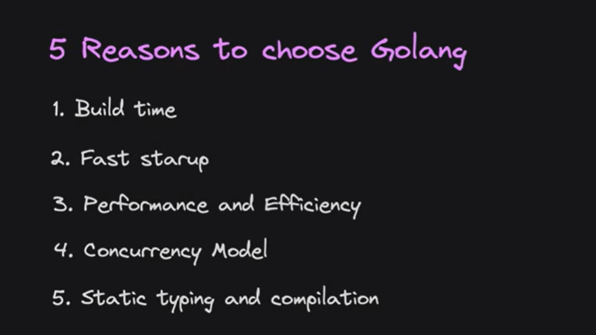
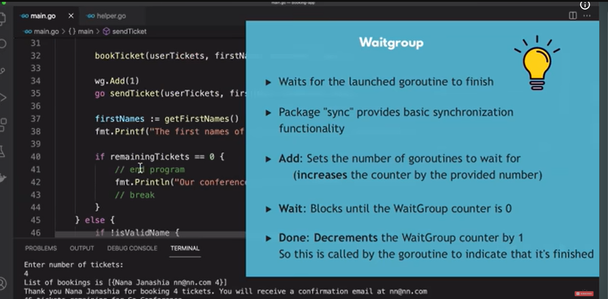

# GoLang

- Go Lang is fast , performant and efficient programming language.
- backed by google and open source community.
- directly compiled to machine code, which makes it faster than interpreted languages.
- concurrency model beats java due to light weight threads (goroutines) powerful multithreaded applications
- All devops tools are written in GoLang (Docker, Kubernetes, Terraform, etc)



Build time : CI-CD pipeline less cost as faster go program builds

Fast Startup : GoLang is compiled language, so it starts faster than interpreted languages like python, ruby, etc

(this is important for microservices architecture where we have multiple services running in parallel) we want new instance to spin up fast and handle requests as soon as possible. (Horizontal scaling)

Efficient usage of memory and cpu (via goroutines) : GoLang is designed to be efficient in terms of memory and CPU usage. It uses goroutines, which are lightweight threads that allow for concurrent execution of code. This means that GoLang can handle a large number of concurrent requests without consuming too much memory or CPU resources.

efficient usage of cpu (concurrency model) : GoLang's concurrency model is based on goroutines and channels, which allows for efficient communication between concurrent processes. This means that GoLang can handle multiple requests simultaneously without blocking or slowing down the application.

also when we build the compiled binary is very smaller in size

## Installation

Download GO onto your system from the official website:

`    https://go.dev/dl/`

Install this extension in vscode for go synatx highlighting and suggestions


Build go program to generate executable binary file using the following command

` go build <path_to_your_go_file>`

To run directly use

`go run <path_to_your_go_file>`

main is the entry point of a go application same like c/c++/java

go coroutines let use run code on separate lightweight threads, which allows for concurrent execution of code. This means that GoLang can handle a large number of concurrent requests without consuming too much memory or CPU resources.

coroutines are lightweight threads and more cheaper to create than actual os threads.

and communication between goroutines is done using channels, which allows for efficient communication between concurrent processes. This means that GoLang can handle multiple requests simultaneously without blocking or slowing down the application.

Java now does this using virtual threads but go has been doing this for a long time and is more efficient than java virtual threads.




go has no classes we create custom types and blueprints via structs and methods. we can create methods on structs and use them like classes in oop languages.

interface define contract just like other laguages, we can implement interfaces on structs and use them like classes in oop languages.

enums are implememted via const and iota in go. we can create enums using const and iota.

# Go Pointers and "Reference Types"

**Yes, pointers work on "reference types" in Go, but you almost never need them.** 

Technically speaking, Go is strictly a **pass-by-value language**. What developers commonly call "reference types" (like **slices, maps, and channels**) are actually small struct headers that internally contain a pointer to an underlying data structure. 

Because they already hold internal pointers, passing a map or a slice to a function copies the lightweight header, but still points to the exact same underlying data. 

---

### When pointers to reference types are actually useful

You only use a pointer to a reference type if you need to **modify the header itself** (such as changing its memory address, length, or capacity).

#### 1. Slices (`*[]T`)
If you pass a slice directly to a function and use `append()`, a re-allocation might trigger. This creates a new underlying array and updates the header's length/capacity, but that update is lost to the caller. You use a pointer to ensure the caller sees the assignment.

```go
// Without a pointer: The caller's slice won't see the new element if it reallocates
func failAppend(s []int) {
    s = append(s, 42) 
}

// With a pointer: Modifies the caller's slice header directly
func successAppend(s *[]int) {
    *s = append(*s, 42) 
}
```

#### 2. Maps (`*map[K]V`)
You almost **never** need a pointer to a map (`*map[string]int`) because modifying, adding, or deleting keys alters the underlying data structure directly. The only exception is if you want to initialize a `nil` map inside a function and have that initialization reflect back to the caller:

```go
func initializeMap(m *map[string]int) {
    if *m == nil {
        *m = make(map[string]int) // Instantiates the map for the caller
    }
    (*m)["status"] = 200
}
```

---

### Summary Reference Guide

| Type | Do you need a pointer (`*`) to mutate data? | Reason |
| :--- | :--- | :--- |
| **Slices** | **Only** if changing length/capacity (`append`) | Internal header has pointer, length, and capacity. |
| **Maps** | **No** (Except to assign a brand new map) | Maps are already pointers to runtime descriptors under the hood. |
| **Channels**| **No** | Channels are handles to a shared queue pointer. |


# Go Language "Char" Data Type Summary

In **Go (Golang)**, there is no explicit `char` data type. Instead, Go handles characters using two distinct numeric types wrapped in single quotes (`'a'`):

* **`rune`**: An alias for **`int32`**. It represents a Unicode code point. It uses **4 bytes** of memory and can store any character, including emojis, Chinese characters, and special symbols.
* **`byte`**: An alias for **`uint8`**. It uses **1 byte** of memory and is used to store standard ASCII characters.

---

### Copyable Code Example

```go
package main

import (
	"fmt"
	"reflect"
)

func main() {
	// 1. Using a 'rune' for Unicode/UTF-8 characters
	var myRune rune = 'A'
	speciaChar := '🚀' // Infers as rune automatically

	// 2. Using a 'byte' for basic ASCII characters
	var myByte byte = 'a'

	// Printing values
	fmt.Println("--- Character Values ---")
	fmt.Printf("myRune (Character): %c\n", myRune)
	fmt.Printf("myRune (Unicode Code Point): %d\n", myRune)
	fmt.Printf("speciaChar (Character): %c\n", speciaChar)
	fmt.Printf("myByte (Character): %c\n", myByte)

	// Printing underlying types
	fmt.Println("\n--- Underlying Types ---")
	fmt.Println("myRune type:", reflect.TypeOf(myRune))       // int32
	fmt.Println("speciaChar type:", reflect.TypeOf(speciaChar)) // int32
	fmt.Println("myByte type:", reflect.TypeOf(myByte))       // uint8

	// 3. Iterating over a string returns runes
	fmt.Println("\n--- Iterating a String ---")
	str := "Go🏃"
	for index, char := range str {
		fmt.Printf("Index: %d | Character: %c | Type: %s\n", index, char, reflect.TypeOf(char))
	}
}
```

---

### Core Mechanics Comparison

| Feature | `byte` | `rune` |
| :--- | :--- | :--- |
| **Underlying Type** | `uint8` (1 byte) | `int32` (4 bytes) |
| **Primary Use Case** | Standard **ASCII** text data | Complete **Unicode / UTF-8** symbols |
| **Syntax Declaration** | Single quotes (e.g., `'a'`) | Single quotes (e.g., `'🚀'`) |
| **String Loops** | Standard `for i` loop accesses raw bytes | `for range` loop automatically decodes runes |


go build (build the binary executble or .exe based on your os (windows/linux/mac))

go build -o <output_file_name> (builds the binary executable with the given name)

go.mod is like the package.json file in nodejs or pom.xml in java. It contains the dependencies of your go project.

go.sum is like the package-lock.json file in nodejs  It contains the dependencies of your go project.it locks all the versions of the packages being used in your project. It is automatically generated when you run `go mod tidy` or `go mod vendor`. It is used to ensure that the same versions of the packages are used across different environments and machines.

Best docs for learning goLang are:

https://go.dev/tour/basics/2

https://gobyexample.com/

https://go.dev/doc/effective_go

https://go.dev/ref/spec


Official standard library of go package 

https://pkg.go.dev/std

https://pkg.go.dev/strings@go1.27.2#ToUpper

https://pkg.go.dev/os@go1.27.2


## Web Frameworks in GoLang 


Gin - Gin is a web framework written in Go (Golang). It is designed to be fast, efficient, and easy to use, making it a popular choice for building web applications and APIs. Gin provides a simple and intuitive API for routing, middleware, and request handling, and it is optimized for performance and scalability. It also includes features such as JSON validation, error handling, and rendering templates.

https://gin-gonic.com/en/docs/

Fiber - just like expressjs in nodejs. It is a fast, minimalist web framework for Go that is designed to be easy to use and efficient. It provides a simple and intuitive API for building web applications and APIs, and it is optimized for performance and scalability. Fiber is built on top of the Fasthttp package, which is a high-performance HTTP server library for Go.

https://gofiber.io/


echo = Echo is a high-performance, extensible, and minimalist web framework for Go (Golang). It is designed to be fast and efficient, making it a popular choice for building web applications and APIs. Echo provides a simple and intuitive API for routing, middleware, and request handling, and it is optimized for performance and scalability. It also includes features such as request validation, error handling, and rendering templates.

https://echo.labstack.com/